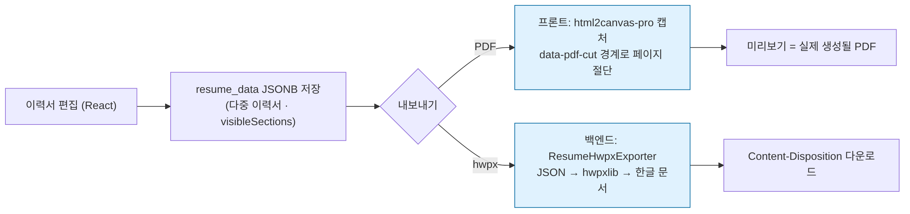

<div align="center">

# K-OSP Frontend

**한국기술교육대학교 오픈소스 프로젝트 플랫폼**

[](https://nextjs.org/)
[](https://react.dev/)
[](https://www.typescriptlang.org/)
[](https://tailwindcss.com/)
[](./LICENSE)

</div>

---

## Overview

KOSP(KOREATECH Open Source Platform)는 한국기술교육대학교 구성원을 위한 오픈소스 프로젝트 협업 플랫폼입니다. 팀 구성, 프로젝트 모집, 커뮤니티, 챌린지 등 오픈소스 활동에 필요한 기능을 통합 제공합니다.


## Team & Roles

| 담당 | 영역 |
|---|---|
| **윤우성** (팀장, 2026.02~) | 이력서 편집기·다중 이력서·PDF/hwpx 출력(`src/app/user/resume`, `src/common/utils/generateResumePdf.ts`) · 칭호 UI(`admin/titles`) · 시즌 티어(`ranking/tier`) · 학습자료(`user/materials`) · 팔로우 · 공지/FAQ · Notion 작업로그 CI |
| 강준형 | 조직·관리자·수집 현황·랭킹 페이지 외 |
| 김민지 | 디자인 |
| 2026년 이전 | 박태진 · 김혜준 외 |

백엔드: [KOREATECH-OSP/KOSP-Backend](https://github.com/KOREATECH-OSP/KOSP-Backend) (Java 17 · Spring Boot 3.5 · PostgreSQL · RabbitMQ)

## Decisions — 선택지와 버린 이유

| 결정 | 선택지 | 고른 것 | 버린 이유 | 근거 |
|---|---|---|---|---|
| **이력서 PDF 생성 위치** | ① 서버에서 HTML→PDF ② 브라우저에서 DOM 캡처(html2canvas + jsPDF) | **②** | 미리보기 화면과 PDF가 **같은 DOM**이어야 "보이는 그대로 받는다"가 성립. 서버 렌더는 폰트·CSS 재현 비용이 크고 미리보기와 어긋난다 | `generateResumePdf.ts` |
| **캡처 라이브러리** | ① `html2canvas` ② `html2canvas-pro` | **②로 교체** | Tailwind 4가 색상을 `oklch()`로 내보내는데 html2canvas가 파싱하지 못해 PDF 생성 자체가 실패. pro는 드롭인 대체로 최신 색상 함수 지원 | `a9047fc` (6/23) |
| **페이지 절단 후보 식별** | ① 클래스명·`nth-child` ② 태그명 ③ 전용 `data-pdf-cut` 속성 | **③** | ①②는 스타일을 손대는 순간 조용히 깨진다. 용도가 이름에 드러나는 data 속성은 실수로 지울 위험이 낮다 | `fbe3502` (9/19) |
| **hwpx(한글) 미리보기** | ① hwpx 자체 렌더 ② PDF 미리보기로 통일 | **②** | 브라우저가 hwpx를 렌더링할 수 없다. hwpx는 백엔드가 생성하고, 사용자는 PDF 미리보기로 내용을 확인한 뒤 원하는 형식을 내려받는다 | `ffb3b90` (9/19) |



## Troubleshooting

### 이력서 PDF가 글자 중간에서 잘림 (9/19, `fbe3502`)

**증상** 프로젝트를 10건 넣은 이력서를 PDF로 받으면 페이지 경계에서 글자가 가로로 잘린다.

**원인** 측정 단위가 너무 굵었다. 절단 후보를 캡처 영역의 **직계 자식(`<section>`) 경계**에서만 찾았는데, 프로젝트 10건은 `<Section title="프로젝트">` 하나라 자를 곳이 섹션 끝 한 군데뿐. 그 높이가 A4를 넘으면 후보가 없어 강제 절단.

**Before** — 섹션 경계만

```ts
// src/common/components/PdfDownloadButton.tsx (fbe3502 이전)
function collectSectionCutPoints(target: HTMLElement, canvasHeight: number): number[] {
  const targetTop = target.getBoundingClientRect().top;
  const ratio = canvasHeight / (target.scrollHeight || 1);
  const points = Array.from(target.children)                 // ← <section> 만
    .map((child) => Math.round((child.getBoundingClientRect().bottom - targetTop) * ratio))
    .filter((y) => y > 0 && y < canvasHeight);
  return Array.from(new Set(points)).sort((a, b) => a - b);
}
```

**After** — 섹션 경계 ∪ 항목 경계, 숨겨진 요소 제외, 최소 채움 비율

```ts
// src/common/utils/generateResumePdf.ts
const CUT_POINT_SELECTOR = '[data-pdf-cut]';   // 프로젝트·경력·학력·수상·자격증 등 9곳에 부착
const MIN_PAGE_FILL_RATIO = 0.15;               // 몇 px짜리 페이지가 생기면 차라리 강제 절단

function measureCutPoints(root: HTMLElement): number[] {
  const rootTop = root.getBoundingClientRect().top;
  const collect = (elements: Element[]) =>
    elements.map((el) => el.getBoundingClientRect())
      .filter((rect) => rect.height > 0)         // 숨겨진 요소는 0높이 페이지를 만든다
      .map((rect) => Math.round(rect.bottom - rootTop));
  const sectionEdges = collect(Array.from(root.children));
  const itemEdges = collect(Array.from(root.querySelectorAll(CUT_POINT_SELECTOR)));
  return Array.from(new Set([...sectionEdges, ...itemEdges].filter((y) => y > 0))).sort((a, b) => a - b);
}
```

**결과** 슬라이스 시뮬레이션 기준 강제 절단 **5회 → 0회**. 페이지 수 10 → 12 (글자를 자르지 않는 대가). 항목 하나가 한 페이지보다 크면 강제 절단이 불가피하므로 그대로 두되 `console.warn`으로 횟수를 보고한다.

**남은 것** 측정 시점(`onclone` 안, 변형 완료 후)과 배율(`PDF_CAPTURE_SCALE` 상수 직접 사용, 역산 금지)은 그대로 유지. 이 둘을 바꾸면 좌표계가 어긋나 같은 버그가 다른 모양으로 돌아온다.

### 그 외

| 증상 | 원인 | 조치 | 커밋 |
|---|---|---|---|
| PDF 생성 시 `unsupported color function oklch` | Tailwind 4 색상 함수를 html2canvas가 미지원 | `html2canvas-pro`로 교체 | `a9047fc` |
| PDF에 모달·off-screen 요소가 섞임 | 캡처 대상이 편집 폼 | 캡처 대상을 `ReadOnlyView`로 교체, off-screen 요소는 `onclone`에서 (0,0) 이동 후 캡처 | `ca10c69` 외 |
| 팔로우·학습자료 조회 실패 시 내 정보 페이지 전체가 죽음 | 하위 API 하나의 실패가 페이지 렌더를 중단 | 섹션별 실패 격리 | `a9659de` |
| `<a>` 태그로 ESLint 빌드 실패(Amplify) | Next 규칙 위반 | `<Link>`로 교체 | `4dfe9d2` |
| 배포됐는데 기능이 동작 안 함 (반복) | 커밋되지 않은 변경이 로컬에만 있었음 | "깨끗한 worktree에서 검증" 규칙 | — |

## Numbers

| 구분 | 값 |
|---|---|
| 본인 커밋 | 58건 (2026.04 ~ 09), 이력서 영역 56건 |
| 절단 후보 | 섹션 1곳 → 섹션 + 항목 9종 (`data-pdf-cut`) |
| 강제 절단 | 5회 → 0회 (시뮬레이션) |
| 운영 | 교내 실사용자, AWS Amplify 배포, Sentry 연동 |

측정하지 못한 것: 실제 사용자 PDF 생성 실패율 (Sentry 이벤트로 추적 가능하나 집계하지 않음).

## Limits

- 페이지 수가 늘어나는 대가를 치렀다. 항목 경계가 촘촘하면 페이지가 일찍 넘어간다. `MIN_PAGE_FILL_RATIO`로 극단만 막았고, 최적 절단은 하지 않았다.
- PDF는 DOM 캡처 방식이라 텍스트 선택·검색이 안 되는 이미지 PDF다. 텍스트 PDF가 필요하면 서버 렌더로 가야 한다.
- 상당량을 AI 코딩 도구로 작성했다. 그래서 커밋 본문에 원인·대안·검증을 남기는 규칙을 두었다(`fbe3502` 메시지가 그 예).

## Features

| 기능 | 설명 |
|------|------|
| **커뮤니티** | 게시판 기반의 자유 게시글 작성 및 토론 |
| **모집공고** | 오픈소스 프로젝트 팀원 모집 및 지원 |
| **팀 관리** | 팀 생성, 초대, 멤버 관리 |
| **챌린지** | GitHub 활동 기반 챌린지 시스템 |
| **관리자 패널** | 사용자/권한/콘텐츠/정책 통합 관리 |
| **알림** | 실시간 알림 시스템 |
| **검색** | 통합 검색 기능 |

## Tech Stack

- **Framework** — Next.js 15 (App Router)
- **Language** — TypeScript 5
- **Styling** — Tailwind CSS 4
- **Rich Text Editor** — Lexical
- **Code Editor** — Monaco Editor
- **UI Components** — Radix UI, Headless UI
- **Animation** — GSAP
- **Icons** — Lucide React, Bootstrap Icons
- **Toast** — Sonner
- **Validation** — Zod

## Getting Started

### Prerequisites

- Node.js 20+
- npm

### Installation

```bash
# 저장소 클론
git clone https://github.com/KOREATECH-OSP/KOSP-Frontend.git
cd KOSP-Frontend

# 의존성 설치
npm install

# 개발 서버 실행
npm run dev
```

[http://localhost:3000](http://localhost:3000)에서 확인할 수 있습니다.

### Scripts

```bash
npm run dev       # 개발 서버 실행
npm run build     # 프로덕션 빌드
npm run start     # 프로덕션 서버 실행
npm run lint      # 코드 린트
```

## Project Structure

```
src/
├── app/                  # App Router 페이지 및 레이아웃
│   ├── admin/            # 관리자 페이지
│   ├── auth/             # 인증 콜백
│   ├── challenge/        # 챌린지
│   ├── community/        # 커뮤니티 게시판
│   ├── recruit/          # 모집공고
│   ├── team/             # 팀 관리
│   ├── user/             # 사용자 프로필
│   ├── notification/     # 알림
│   └── search/           # 검색
├── common/               # 공용 컴포넌트, 훅, 유틸리티
├── lib/                  # API 클라이언트, 인증, 유틸리티
├── assets/               # 정적 자원
├── mocks/                # 목업 데이터
└── types/                # 타입 정의
```

## Contributing

1. `develop` 브랜치에서 새 브랜치를 생성합니다.
2. 변경 사항을 커밋합니다.
3. `main` 브랜치로 Pull Request를 생성합니다.

## License

이 프로젝트는 [MIT License](./LICENSE)에 따라 배포됩니다.

Copyright (c) 2025 Korea University of Technology and Education
